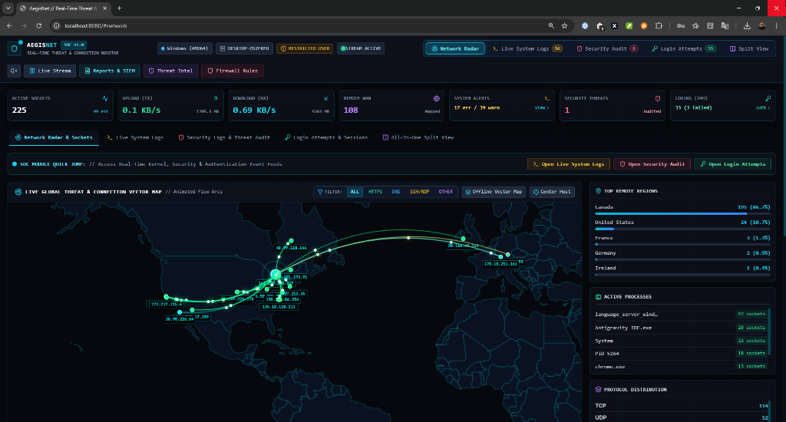

# 🛡️ AegisNet SOC // Real-Time Threat & Network Security Platform

<div align="center">

[](docs/screenshots/aegisnet_soc_preview.png)

### **Autonomous SOC Defense, Live Socket Interceptor & Native Desktop Suite**

[](https://github.com/mehdisec)
[](https://github.com/mehdisec/AegisNet-SOC/releases/latest)
[](https://www.python.org/)
[](https://pywebview.flowrl.com/)
[](LICENSE)
[](https://github.com/mehdisec)

[English Documentation](README.md) • [راهنمای فارسی](README_FA.md) • [⚡ Download Setup EXE](https://github.com/mehdisec/AegisNet-SOC/releases/latest) • [Quick Start](#-quick-start) • [Desktop App](#-native-desktop-suite) • [Author](#-author--attribution)

</div>

---

## 🌟 Executive Overview

**AegisNet** is an enterprise-grade, zero-bloat Cyber Threat Intelligence (CTI) and Security Operations Center (SOC) platform designed for live network telemetry, real-time threat detection, and instant incident response.

Unlike heavyweight Electron-based tools, AegisNet runs natively as an ultra-fast desktop application via **pywebview** (leveraging Microsoft Edge WebView2 on Windows and WebKitGTK on Linux) or as a headless web dashboard accessible across the local network on port `8080`.

It visualizes inbound and outbound network flows on a high-contrast dark cartographic map with GPU-accelerated particle arcs, performs automated threat intelligence reputation scoring, streams live kernel/system logs, audits login attempts for brute-force attacks, and empowers security operators to enforce one-click native OS firewall blocks (`netsh` / `iptables`).

---

## ✨ Key Features

### 🖥️ Native Desktop Application (Windows & Linux)
- **Zero-Bloat Footprint:** Built on native webview runtimes (under 50MB RAM compared to 500MB+ for Electron).
- **Minimalist Cyber Intro Animation:** High-tech SOC boot sequence upon application launch displaying kernel initialization, GeoIP telemetry mounting, and author credentials.
- **Graceful Termination Animation:** Smooth exit overlay disengaging telemetry and safely severing background threads.
- **Hardware Acceleration:** Canvas quadratic Bezier particle arcs rendered at 60 FPS.

### 🌐 Real-Time Socket Interceptor & GeoIP Radar
- Continuous sniffing of local and remote sockets (TCP/UDP, IPv4/IPv6).
- Direct extraction of PID, executable path, process memory/CPU consumption, and socket state (`ESTABLISHED`, `LISTEN`, `TIME_WAIT`).
- Real-time ASN, ISP, country, city, and geographic coordinate resolution (MaxMind GeoLite2 + LRU caching).
- Calculation of live TX/RX network throughput (KB/s, Mbps) and packet rates.

### 🛡️ Threat Intelligence & Autonomous Threat Detection
- **Integrated Threat Engine:** Immediate classification of suspicious connections into `CLEAN`, `SUSPICIOUS`, or `MALICIOUS`.
- **Cross-Platform Threat Detector (`log_threat_detector.py`):** Real-time automated MITRE ATT&CK signature scanning across system and security logs for Windows and Linux:
  - SSH / RDP Brute-Force authentication attacks.
  - Sudo privilege escalation and Polkit authorization bypass attempts.
  - Shadow copy deletion and ransomware staging commands (`vssadmin delete shadows`).
  - PowerShell execution policy bypass and Mimikatz memory dump detections.
  - Kernel memory segmentation faults (`segfault`) and Out-Of-Memory (OOM) killer spikes.
  - UFW / iptables dropped packets and Windows Filtering Platform (WFP) network blocks.
- **Log Threat Detection Radar:** On-demand API trigger (`/api/logs/scan-threats`) and visual scanning radar in the SOC dashboard.
- **Tor Exit Node Radar:** Real-time correlation against active Tor directory relays.
- **Interactive Intel Modal:** Instant on-demand reputation queries for any public IP.

### 📋 Live OS System Logs, Security Audit & Login Attempts (Zero-Simulated Telemetry)
- **100% Genuine Operating System Data:** All synthetic/simulated dummy data completely eliminated. Every event displayed originates directly from the host operating system.
- **Multi-Source Linux Ingestion:** Robust multi-tier log harvester supporting `journalctl -o json` (with byte-array decoding), raw `journalctl`, `/var/log/syslog`, `/var/log/messages`, `dmesg -T`, and `/var/log/auth.log`.
- **Multi-Channel Windows Security Harvest:** Comprehensive log collection spanning the `Security` channel (admin audit), `Windows Defender/Operational` (malware detection, action taken, tampering), `System` (Event 7045 service creation, Event 104 log cleared), and `PowerShell/Operational` (Event 4104 ScriptBlock logging).
- **Authentication & Brute-Force Radar:** Live tracking of console and RDP logons (Windows Event IDs 4624/4625 & TerminalServices-LocalSessionManager; Linux `last`/`lastb`). Automatic alert triggers when failed login frequency spikes.

### ⚡ Active Incident Response & Firewall Orchestration
- **Process Termination:** Immediate soft termination or forced kill of rogue processes.
- **Native OS Firewall Blocking:**
  - **Windows:** Adds native `netsh advfirewall` drop rules for inbound and outbound traffic.
  - **Linux:** Inserts `iptables` / `nftables` drop rules.
- **Firewall Rules Manager:** Visual audit modal to view and unblock any blacklisted IP.
- **SIEM & Incident Reporting:** Export incidents into CEF (Common Event Format) for Splunk/Wazuh/QRadar, or download structured CSV logs and Executive Incident Briefings.

---

## 📦 Automated Installation Packages

### 🪟 Windows Setup (Automated Installer)
AegisNet includes a one-click automated setup wizard for Windows 10/11:

1. Double-click **`install_windows.bat`** (or right-click and select **"Run as Administrator"** for full firewall privileges).
2. The installer will automatically:
   - Check and configure Python 3.10+.
   - Create a dedicated virtual environment (`.venv`).
   - Install all required packages (`fastapi`, `uvicorn`, `psutil`, `pywebview`, `Pillow`).
   - Download the MaxMind GeoIP city database.
   - Generate project icons (`icon.ico`, `icon.png`, `favicon.ico`).
   - Create a **Desktop Shortcut** (`AegisNet SOC.lnk`) and a **Start Menu Shortcut**.

To launch AegisNet at any time:
- Launch via the Desktop shortcut, or
- Run `scripts/run_windows.bat` from terminal.

---

### 🐧 Linux Setup (Automated Installer)
AegisNet provides a full Linux installer supporting Ubuntu/Debian, Arch, and Fedora:

1. Open terminal and run:
   ```bash
   chmod +x install_linux.sh scripts/run_linux.sh
   ./install_linux.sh
   ```
   *(For root firewall integration, run: `sudo ./install_linux.sh`)*

2. The installer will automatically:
   - Install WebKitGTK desktop runtime dependencies.
   - Configure Python `.venv` and install `requirements.txt`.
   - Download GeoIP database and generate icons.
   - Create a desktop entry in `~/.local/share/applications/aegisnet.desktop` (accessible via your application menu).
   - Create a CLI launcher symlink `aegisnet` in `~/.local/bin/` (or `/usr/local/bin/`).

To launch on Linux:
```bash
# Desktop GUI Mode:
aegisnet
# Or:
./scripts/run_linux.sh --desktop

# Headless Web Server Mode (Port 8080):
./scripts/run_linux.sh --server
```

---

## 🚀 Manual Quick Start

If you prefer to run directly without installing shortcuts:

```bash
# 1. Clone repository
git clone https://github.com/mehdisec/aegisnet-soc.git
cd aegisnet-soc

# 2. Install dependencies
pip install -r requirements.txt

# 3. Launch Native Desktop App
python desktop_app.py

# Or launch Headless Server Mode (Accessible at http://localhost:8080)
python -m uvicorn backend.server:app --host 0.0.0.0 --port 8080
```

---

## 🏛️ Project Directory Structure

```
.
├── desktop_app.py            # Native Desktop GUI client (pywebview + Edge/WebKit)
├── install_windows.bat       # Windows 1-click automated installer & shortcut generator
├── install_linux.sh          # Linux 1-click automated installer & desktop entry generator
├── requirements.txt          # Python runtime dependencies
├── LICENSE                   # MIT Open Source License
├── README.md                 # English documentation
├── README_FA.md              # Persian documentation (راهنمای جامع فارسی)
├── icon.ico                  # High-resolution multi-size Windows icon
├── backend/
│   ├── config.py             # System paths, default port 8080, buffer limits
│   ├── os_detector.py        # Host OS detection, architecture, and privilege audit
│   ├── geoip_service.py      # MaxMind mmdb + async LRU IP resolver
│   ├── network_monitor.py    # Socket interceptor, protocol inference & bandwidth telemetry
│   ├── threat_intel.py       # Threat scoring, Tor exit directory, botnet signature detector
│   ├── log_monitor.py        # Windows Event Log & Linux journalctl system/security/auth parser
│   ├── log_threat_detector.py # MITRE ATT&CK signature rules & heuristic log scanner
│   ├── firewall_manager.py   # Native OS netsh & iptables rule enforcement
│   ├── report_generator.py   # SIEM CEF format exporter & executive briefing generator
│   └── server.py             # FastAPI REST & WebSocket streaming hub
├── geo-arcs-map/             # Standalone reusable curved particle arcs & map package
├── frontend/
│   ├── index.html            # Dark-mode SOC dashboard with tabbed telemetry panes
│   ├── favicon.ico           # Project favicon
│   ├── css/
│   │   └── styles.css        # Cyber theme, glassmorphism, animations, splash screens
│   ├── static/img/
│   │   ├── icon.svg          # Vector cyber shield icon
│   │   ├── icon.png          # 512x512 High-res PNG icon
│   │   └── icon.ico          # Multi-size Windows ICO
│   └── js/
│       ├── app.js            # App controller, audio FX, intro animation, desktop hooks
│       ├── logs.js           # Live system, security, and authentication telemetry manager
│       ├── map.js            # Leaflet map + Canvas particle arcs
│       ├── inspector.js      # Slide-out IP inspector and incident action trigger
│       └── world-data.js     # Fallback offline country boundary centroids
└── scripts/
    ├── run_windows.bat       # Windows multi-mode launcher (Desktop, Server, Installer)
    ├── run_linux.sh          # Linux multi-mode launcher (Desktop, Server, Installer)
    ├── download_geoip.py     # MaxMind GeoLite2 automated downloader
    └── generate_icons.py     # High-resolution icon generator
```

---

## 📡 REST & WebSocket API Overview

| Endpoint | Method | Description |
| :--- | :--- | :--- |
| `/api/system/status` | `GET` | Host OS, architecture, hostname, privilege level, and anchor coordinates. |
| `/api/connections/active` | `GET` | Instant snapshot of active sockets, top processes, and bandwidth statistics. |
| `/api/geoip/lookup/{ip}` | `GET` | GeoIP lookup (country, city, coordinates, ISP, ASN, org). |
| `/api/intel/lookup` | `GET` | Threat reputation score (0-100), verdict, category, and signatures. |
| `/api/intel/tor-exit-nodes` | `GET` | List of currently active Tor exit relays. |
| `/api/logs/system` | `GET` | Stream live OS kernel and system events. |
| `/api/logs/security` | `GET` | Stream host audit incidents, Defender alerts, and firewall drops. |
| `/api/logs/logins` | `GET` | Stream authentication attempts and active interactive user sessions. |
| `/api/logs/scan-threats` | `POST` | On-demand MITRE ATT&CK log scanner across system and security logs. |
| `/api/reports/siem-export` | `GET` | Download security incidents formatted in SIEM CEF (Common Event Format). |
| `/api/actions/terminate` | `POST` | Terminate or kill socket process by PID (`{"pid": 1234}`). |
| `/api/actions/block-ip` | `POST` | Enforce native OS firewall drop rule (`{"ip": "x.x.x.x", "reason": "..."}`). |
| `/api/actions/unblock-ip` | `POST` | Remove native OS firewall drop rule (`{"ip": "x.x.x.x"}`). |
| `/ws/live` | `WebSocket` | Real-time bi-directional telemetry stream of network flows & log counters. |

---

## 👤 Author & Attribution

- **Lead Architect & Creator:** **Mehdi Mirzaei**
- **Email:** [Mehdisec@gmail.com](mailto:Mehdisec@gmail.com)
- **GitHub:** [https://github.com/mehdisec](https://github.com/mehdisec)
- **Portfolio & Website:** [https://github.io/mehdisec](https://github.io/mehdisec)

---

## 📄 License

This project is licensed under the terms of the **MIT License**. See the [LICENSE](LICENSE) file for complete details.
