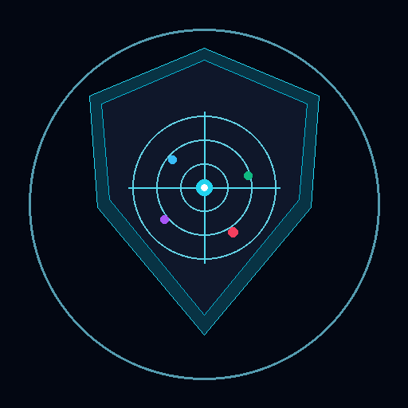
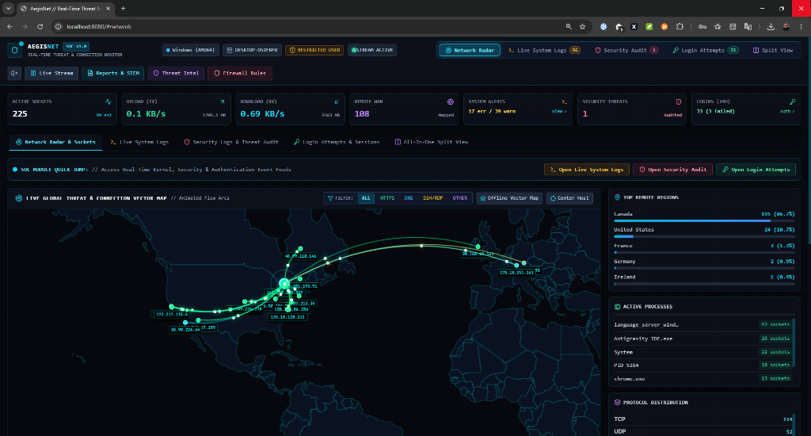

# 🛡️ پلتفرم امنیتی و مرکز عملیات امنیت AegisNet SOC

<div align="center" dir="rtl">



### **سامانه پایش بلادرنگ سوکت‌ها، رادار هوش تهدیدات و نرم‌افزار دسکتاپ بومی**

[](https://github.com/mehdisec)
[](https://www.python.org/)
[](https://pywebview.flowrl.com/)
[](LICENSE)
[](https://github.com/mehdisec)

[راهنمای انگلیسی (English)](README.md) • [نصب سریع](#-نصب-سریع-با-پکیج‌های-نصب-خودکار) • [نسخه دسکتاپ](#-نسخه-دسکتاپ-بومی-windows--linux) • [مشخصات صاحب اثر](#-مشخصات-صاحب-اثر-و-تماس)

<br/><br/>

[](docs/screenshots/aegisnet_soc_preview.png)

</div>

---

## 🌟 معرفی پروژه

**AegisNet** یک پلتفرم جامع، مدرن و عملیاتی در حوزه مراکز عملیات امنیت (SOC) و اطلاعات تهدیدات سایبری (CTI) است که با هدف نظارت لحظه‌ای بر ارتباطات شبکه، کشف رفتارهای مشکوک و پاسخ آنی به حوادث امنیتی مهندسی شده است.

برخلاف برنامه‌های حجیم مبتنی بر Electron که صدها مگابایت رم مصرف می‌کنند، **AegisNet** به عنوان یک نرم‌افزار دسکتاپ فوق‌العاده سبک و بومی با استفاده از موتور وب‌ویوی بومی سیستم‌عامل (**Microsoft Edge WebView2** در ویندوز و **WebKitGTK** در لینوکس) اجرا می‌شود و همچنین امکان اجرا به صورت یک وب‌سرور متمرکز روی پورت `8080` برای دسترسی تحت شبکه را فراهم می‌سازد.

---

## ✨ قابلیت‌ها و ویژگی‌های کلیدی

### 🖥️ ۱. نسخه دسکتاپ بومی و سبک (Windows & Linux)
- **سبک و بدون اتلاف منابع (Zero-Bloat):** مصرف رم کمتر از ۵۰ مگابایت در مقایسه با بیش از ۵۰۰ مگابایت در ابزارهای الکترونی.
- **انیمیشن اینترو مینیمال (Intro Animation):** دارای سکانس استارت و بوت سایبری هنگام اجرای برنامه دسکتاپ با نمایش وضعیت هسته، لود دیتابیس GeoIP و مشخصات طراح.
- **انیمیشن خروج ایمن (Shutdown Animation):** دارای افکت بستن زیبا هنگام خروج از نرم‌افزار جهت آزادسازی پورت‌ها و تردها به شکل کاملاً امن.
- **شتاب‌دهی سخت‌افزاری:** رندرینگ روان ذرات و منحنی‌های ترافیکی با ۶۰ فریم بر ثانیه.

### 🌐 ۲. رهگیری بلادرنگ سوکت‌ها و نقشه ژئوپلیتیک ترافیک
- پایش لحظه‌ای تمامی اتصالات شبکه (TCP / UDP / IPv4 / IPv6) با پروتکل‌های وب، DNS، SSH، RDP و پورت‌های سفارشی.
- استخراج بلادرنگ شناسه پردازه (PID)، مسیر فایل اجرایی برنامه، میزان مصرف پردازنده و رم، و وضعیت اتصال (`ESTABLISHED`، `LISTEN`، `SYN_SENT`).
- محاسبه پهنای باند لحظه‌ای ارسال/دریافت (KB/s و Mbps) و شمارش تعداد پکت‌ها در هر ثانیه.
- اتصال به دیتابیس دقیق MaxMind GeoLite2 به همراه سیستم کش هوشمند و سبک جهت موقعیت‌یابی جغرافیایی دقیق IPهای عمومی.

### 🛡️ ۳. رادار هوش تهدیدات (Threat Intelligence)
- **رتبه‌بندی ریسک IPها:** امتیازدهی خودکار از ۰ تا ۱۰۰ و تعیین وضعیت اتصال در دسته‌های `CLEAN`، `SUSPICIOUS` یا `MALICIOUS`.
- **شناسایی نودهای خروجی تور (Tor Exit Nodes):** اتصال و همگام‌سازی پیوسته با دایرکتوری رله‌های فعال شبکه تور جهت کشف ارتباطات پنهان.
- **ردیابی اسکنرها و بات‌نت‌ها:** پرچم‌گذاری آنی ترافیک مربوط به اسکنرهای اینترنتی مانند Shodan، Censys و سرورهای کنترل بات‌نت Mirai.
- **پنجره استعلام دستی:** امکان جستجو و بررسی سوابق هر آدرس IP دلخواه در مدال ویژه هوش تهدیدات.

### 📋 ۴. لاگ‌های زنده سیستم، حوادث امنیتی و تلاش‌های لاگین
- **لاگ‌های زنده هسته و سیستم (Live System Logs):** اتصال مستقیم به کانال سیستم رویدادهای ویندوز (Windows Event Log) و `journalctl` لینوکس جهت مشاهده خطاهای کرنل، درایورها و کارت شبکه به صورت زنده.
- **لاگ‌های رویدادهای امنیتی (Security Audit):** ثبت اجرای برنامه‌های دارای دسترسی بالا، تغییرات پالیسی‌ها و بستن اتصالات توسط اپراتور.
- **نظارت بر لاگین‌ها و حملات Brute-Force:** رصد نشست‌های جاری، لاگین‌های موفق و ناموفق RDP و کنسول (Event ID 4624/4625). هشدار فوری هنگام افزایش غیرعادی لاگین‌های ناموفق.

### ⚡ ۵. واکنش آنی به حوادث و مدیریت فایروال بومی
- **قطع فوری پروسه (Kill Process):** خاتمه دادن آنی به پروسه مخرب تنها با یک کلیک.
- **بستن بومی در فایروال سیستم‌عامل (Native Firewall Drop):**
  - در ویندوز: اعمال رول‌های مسدودسازی با ابزار `netsh advfirewall`.
  - در لینوکس: اعمال رول مسدودسازی با `iptables` یا `nftables`.
- **مدیریت رول‌های فایروال:** امکان مشاهده تمام IPهای مسدود شده و لغو انسداد (Unblock) به سادگی.
- **خروجی لاگ‌ها برای سامانه‌های SIEM:** امکان دانلود گزارشات امنیتی با فرمت استاندارد CEF (سازگار با Splunk، Wazuh، QRadar) و خروجی اکسل/CSV.

---

## 📦 نصب سریع با پکیج‌های نصب خودکار

### 🪟 راهنمای نصب در ویندوز (Windows Installer)
پروژه شامل اسکریپت نصب خودکار برای ویندوز ۱۰ و ۱۱ است:

1. فایل **`install_windows.bat`** را اجرا کنید (ترجیحاً کلیک راست کرده و **"Run as Administrator"** را بزنید تا دسترسی فایروال کامل باشد).
2. مراحل به صورت خودکار انجام می‌شود:
   - بررسی و تنظیم نسخه پایتون (Python 3.10+).
   - ایجاد محیط مجازی مستقل (`.venv`).
   - نصب کلیه پکیج‌های پیش‌نیاز از `requirements.txt`.
   - دانلود دیتابیس موقعیت‌یابی GeoIP.
   - ایجاد آیکون‌های کیفیت بالای برنامه (`icon.ico` و `icon.png`).
   - ساخت میانبر روی دسکتاپ (**Desktop Shortcut**) و منوی استارت با آیکون اختصاصی.

برای اجرای AegisNet در ویندوز:
- اجرای شورتکات **AegisNet SOC** از روی دسکتاپ، یا
- اجرای فایل `scripts/run_windows.bat` از خط فرمان.

---

### 🐧 راهنمای نصب در لینوکس (Linux Installer)
برای سیستم‌های مبتنی بر اوبونتو، دبیان، آرچ یا فدورا:

۱. ترمینال را باز کرده و دستورات زیر را وارد کنید:
```bash
chmod +x install_linux.sh scripts/run_linux.sh
./install_linux.sh
```
*(برای دسترسی کامل به ابزار iptables، اجرای `sudo ./install_linux.sh` توصیه می‌شود).*

۲. نصاب به صورت خودکار:
- پیش‌نیازهای وب‌ویوی گنو/لینوکس (WebKitGTK) را آماده می‌کند.
- محیط مجازی `.venv` را ساخته و پکیج‌ها را نصب می‌نماید.
- دیتابیس GeoIP را دانلود کرده و آیکون‌ها را می‌سازد.
- لانچر دسکتاپ را در مسیر `~/.local/share/applications/aegisnet.desktop` قرار می‌دهد.
- دستور خط فرمان `aegisnet` را برای اجرای سریع ایجاد می‌کند.

نحوه اجرا در لینوکس:
```bash
# اجرای نسخه دسکتاپ با رابط گرافیکی:
aegisnet
# یا:
./scripts/run_linux.sh --desktop

# اجرای نسخه سرور بدون پنجره (تحت وب روی پورت 8080):
./scripts/run_linux.sh --server
```

---

## 🚀 اجرای دستی بدون نصب

اگر مایل به اجرای مستقیم کدها بدون ساخت شورتکات هستید:

```bash
# ۱. رفتن به مسیر پروژه
cd "d:/1/Live connection"

# ۲. نصب وابستگی‌ها
pip install -r requirements.txt

# ۳. اجرای مستقیم پنجره دسکتاپ
python desktop_app.py

# یا اجرای سرور وب (قابل دسترسی در مرورگر به نشانی http://localhost:8080)
python -m uvicorn backend.server:app --host 0.0.0.0 --port 8080
```

---

## 📁 ساختار پوشه‌ها و معماری پروژه

```
.
├── desktop_app.py            # هسته نرم‌افزار دسکتاپ بومی (pywebview)
├── install_windows.bat       # پکیج نصب خودکار و ساخت شورتکات برای ویندوز
├── install_linux.sh          # پکیج نصب خودکار و ثبت برنامه دسکتاپ برای لینوکس
├── requirements.txt          # لیست پیش‌نیازهای پایتون
├── LICENSE                   # مجوز رسمی متن‌باز MIT
├── README.md                 # مستندات و راهنمای انگلیسی
├── README_FA.md              # مستندات و راهنمای جامع فارسی
├── icon.ico                  # فایل آیکون رزولوشن بالای ویندوز
├── backend/
│   ├── config.py             # تنظیمات اصلی سرور، پورت 8080 و بافرها
│   ├── os_detector.py        # تشخیص سیستم‌عامل، معماری و میزان سطح دسترسی
│   ├── geoip_service.py      # ماژول ژئولوکیشن MaxMind به همراه کش
│   ├── network_monitor.py    # مانیتور بلادرنگ سوکت‌ها، پردازه‌ها و پهنای باند
│   ├── threat_intel.py       # موتور هوش تهدیدات و شناسایی نودهای تور و بات‌نت‌ها
│   ├── log_monitor.py        # پردازش لاگ‌های سیستمی، امنیتی و رویدادهای ورود
│   ├── firewall_manager.py   # ماژول مدیریت فایروال بومی (netsh و iptables)
│   ├── report_generator.py   # تولید گزارشات مدیریتی و خروجی SIEM CEF
│   └── server.py             # سرور اصلی FastAPI و جریان وب‌سوکت
├── frontend/
│   ├── index.html            # رابط کاربری تحت وب و دسکتاپ
│   ├── favicon.ico           # فاوآیکون پروژه
│   ├── css/
│   │   └── styles.css        # استایل‌های تم سایبر، شیشه‌ای و انیمیشن‌ها
│   ├── static/img/
│   │   ├── icon.svg          # آیکون وکتور شیلد سایبری
│   │   ├── icon.png          # آیکون تصویری 512x512
│   │   └── icon.ico          # آیکون فرمت ICO
│   └── js/
│       ├── app.js            # کنترلر اصلی، انیمیشن اینترو، خروج و صدای سایبری
│       ├── logs.js           # مدیریت تب‌های لاگ‌های سیستم، امنیت و ورودها
│       ├── map.js            # نقشه Leaflet و رندرینگ ذرات ترافیکی
│       └── inspector.js      # پنل کشویی بررسی IP، مسدودسازی و قطع پردازه
└── scripts/
    ├── run_windows.bat       # لانچر چندحالته برای ویندوز
    ├── run_linux.sh          # لانچر چندحالته برای لینوکس
    ├── download_geoip.py     # دانلود خودکار دیتابیس GeoLite2
    └── generate_icons.py     # اسکریپت تولید خودکار آیکون‌ها در ابعاد مختلف
```

---

## 👤 مشخصات صاحب اثر و تماس

- **طراح، معمار و توسعه‌دهنده پروژه:** **مهدی میرزایی (Mehdi Mirzaei)**
- **پست الکترونیک (Email):** [Mehdisec@gmail.com](mailto:Mehdisec@gmail.com)
- **گیت‌هاب (GitHub):** [https://github.com/mehdisec](https://github.com/mehdisec)
- **پورتفولیو و وب‌سایت:** [https://github.io/mehdisec](https://github.io/mehdisec)

---

## 📄 مجوز (License)

این پروژه تحت مجوز متن‌باز **MIT License** منتشر شده است. استفاده، توسعه و سفارشی‌سازی آن با ذکر نام پدیدآورنده آزاد می‌باشد.
